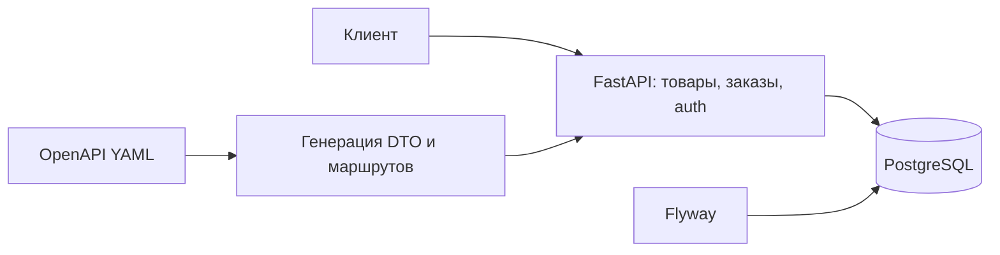

# SOA ДЗ 2 — Marketplace: OpenAPI + CRUD

Продолжение архитектурного ДЗ 1: один сервис API на Python/FastAPI, PostgreSQL и Flyway. Репозиторий содержит исходный OpenAPI-контракт; модели запросов, ответов и маршруты генерируются из него при сборке. Для демонстрации достаточно локального Docker Compose.

## Что реализовано

| Критерий | Где смотреть |
| --- | --- |
| Контракт CRUD товара, схемы, фильтры и пагинация | [`openapi/openapi.yaml`](openapi/openapi.yaml) |
| Генерация DTO и маршрутов из контракта | [`scripts/generate.py`](scripts/generate.py), [`Dockerfile`](Dockerfile) |
| PostgreSQL, миграция Flyway, индекс `products.status`, timestamps, мягкое удаление | [`db/migration/V1__marketplace.sql`](db/migration/V1__marketplace.sql), [`app/handlers.py`](app/handlers.py) |
| Единые ошибки и валидация | [`app/errors.py`](app/errors.py), [`app/main.py`](app/main.py) |
| Заказы, остатки, промокоды, ограничения и состояния | [`app/handlers.py`](app/handlers.py) |
| JSON-журнал с `request_id`, маскировкой паролей и токенов | [`app/main.py`](app/main.py) |
| JWT access/refresh и роли USER, SELLER, ADMIN | [`app/auth.py`](app/auth.py), [`app/handlers.py`](app/handlers.py) |
| Сквозная проверка | [`scripts/smoke.py`](scripts/smoke.py) |

## Запуск

Нужны Docker Engine и Docker Compose. Сервис опубликован только на `127.0.0.1:8001`, PostgreSQL — на `127.0.0.1:5433`; порты можно изменить в `compose.yaml`.

```bash
docker-compose up --build -d
curl -i http://127.0.0.1:8001/health
python3 scripts/smoke.py
```

Ожидаемый ответ health-check: `HTTP/1.1 200 OK`, `{"status":"ok"}`. Интерактивная документация: [Swagger UI](http://127.0.0.1:8001/docs), исходный контракт: [OpenAPI JSON](http://127.0.0.1:8001/openapi.json). Для просмотра запуска и JSON-логов:

```bash
docker-compose logs flyway api
docker-compose logs -f api
```

Остановить сервисы без удаления данных: `docker-compose down`. Полностью сбросить демонстрационную БД: `docker-compose down -v` (удаляет том этого Compose-проекта).

На машине с Colima, если Docker настроен на отсутствующий `docker-credential-desktop`, можно запустить так:

```bash
mkdir -p .docker-config
printf '{}\n' > .docker-config/config.json
DOCKER_CONFIG="$PWD/.docker-config" DOCKER_HOST="unix://$HOME/.colima/default/docker.sock" docker-compose up --build -d
```

Такие же переменные передаются командам `docker-compose logs`, `docker-compose exec` и `docker-compose down`. Файл `.docker-config/` не коммитится.

## Быстрая демонстрация API

В Compose создаётся демонстрационный администратор `admin@example.com` с паролем `admin-demo-password`. Обычного пользователя и продавца можно зарегистрировать через `POST /auth/register` с ролью `USER` или `SELLER` и паролем длиной от 8 символов. Затем получить токены через `POST /auth/login`.

```bash
curl -s http://127.0.0.1:8001/auth/login \
  -H 'Content-Type: application/json' \
  -d '{"email":"admin@example.com","password":"admin-demo-password"}'
```

В ответе `access_token` живёт 20 минут, `refresh_token` — 14 дней. Для CRUD и заказов передавайте `Authorization: Bearer <access_token>`. Полный воспроизводимый сценарий `python3 scripts/smoke.py` самостоятельно создаёт тестовых покупателей и продавца, товары и промокоды, выполняет заказы и проверяет ошибки. Повторный запуск создаёт новые уникальные тестовые email и коды промоакций.

## Контракт и кодогенерация

Одна команда генерации: `python3 scripts/generate.py` после установки зависимостей из `requirements.txt`; во время `docker-compose up --build` она запускается автоматически. `generated/models.py` содержит Pydantic DTO, `generated/routes.py` — маршруты FastAPI, использующие эти DTO и вызывающие бизнес-обработчики. Каталог `generated/` игнорируется Git. Ручных DTO нет. Обновлять API следует в `openapi/openapi.yaml`, затем пересобрать образ.

Версия генератора зафиксирована в `requirements.txt`. В этой версии `datamodel-code-generator` округляет десятичный минимум `0.01` до `0` при генерации ограничения Pydantic. Скрипт генерации исправляет это для Decimal-полей по значениям исходной спецификации. Ошибки входных полей обрабатываются до бизнес-обработчиков как HTTP 400 `VALIDATION_ERROR` с `details.violations`.

Цена передаётся в запросах как десятичное число с двумя знаками, а в ответах — как строка с `format: decimal`: так сумма сохраняет точность без ошибок двоичной арифметики.

## Устройство и принятые решения



Каталог, заказы, промокоды и пользователи находятся в одном сервисе. Заказ, резервирование остатков, применение промокода и запись операции выполняются в одной транзакции PostgreSQL. Для конкурентных заказов используются `SELECT ... FOR UPDATE`, уникальный частичный индекс на активный заказ покупателя и блокировка строки пользователя при проверке лимита частоты. Альтернатива — выделить отдельные сервисы каталога, заказов и платежей; она лучше масштабируется независимо, но для атомарного резерва потребует распределённого согласования, саги и дополнительных отказных сценариев. Для этого задания с локальным запуском и проверкой SQL выбран один сервис.

`DELETE /products/{id}` переводит товар в `ARCHIVED`, сохраняя запись. `created_at` задаёт БД, `updated_at` меняет триггер. При создании заказа цена фиксируется в `order_items.price_at_order`; изменение цены каталога не меняет уже созданный заказ. При редактировании заказа позиции и итог пересчитываются по текущим ценам. Процентная скидка ограничена 70% суммы, фиксированная — суммой заказа. Если промокод после редактирования больше не применим, его использование возвращается. Отмена возвращает остатки и использование промокода. Допустимые статусы: `CREATED → PAYMENT_PENDING → PAID → SHIPPED → COMPLETED`; отмена разрешена из `CREATED` и `PAYMENT_PENDING`. Демонстрационные переходы между платёжными и доставочными статусами делает ADMIN через `POST /orders/{id}/transition`.

Ролевая матрица описана в OpenAPI (`x-roles` и описания операций). USER читает товары и управляет своими заказами, SELLER управляет только собственными товарами и создаёт промокоды, ADMIN управляет всеми товарами и заказами. `GET /products` и `GET /products/{id}` доступны всем авторизованным ролям. Роль хранится в JWT и проверяется в обработчиках. Ошибки имеют единый вид `{"error_code":"...","message":"...","details":{...}}`; соответствие кодов HTTP-статусам перечислено в `x-error-codes` спецификации.

Для разработки и защиты секрет JWT и пароль администратора явно заданы в `compose.yaml`. Перед любым внешним развёртыванием их необходимо заменить и управлять ими вне репозитория.

## Проверка и защита

Сквозная проверка:

```bash
python3 scripts/smoke.py
```

Она проверяет регистрацию и обновление токена, запреты ролей, ограничения полей, CRUD и мягкое удаление товаров, фильтрацию, ошибки недостатка остатков и неактивного товара, промокоды, создание/обновление/отмену заказа, лимит частоты, владение заказом и модель состояний. Ответ каждого запроса проверяется по HTTP-статусу и заголовку `X-Request-Id`.

Для показа таблиц преподавателю после прогона сценария:

```bash
docker-compose exec -T db psql -U marketplace -d marketplace -c \
  'SELECT id, name, status, stock, price, seller_id FROM products ORDER BY created_at DESC LIMIT 10;'
docker-compose exec -T db psql -U marketplace -d marketplace -c \
  'SELECT id, user_id, status, total_amount, discount_amount, promo_code_id FROM orders ORDER BY created_at DESC LIMIT 10;'
docker-compose exec -T db psql -U marketplace -d marketplace -c \
  'SELECT order_id, product_id, quantity, price_at_order FROM order_items ORDER BY id DESC LIMIT 10;'
docker-compose exec -T db psql -U marketplace -d marketplace -c \
  'SELECT code, current_uses, max_uses, active FROM promo_codes ORDER BY id DESC LIMIT 10;'
docker-compose exec -T db psql -U marketplace -d marketplace -c \
  'SELECT user_id, operation_type, created_at FROM user_operations ORDER BY created_at DESC LIMIT 10;'
```

Повторяющийся заказ/обновление в пределах `ORDER_COOLDOWN_MINUTES` возвращает 429. В Compose значение равно 1 минуте. Вторая попытка создать заказ после истечения задержки при активном заказе возвращает 409 `ORDER_HAS_ACTIVE`.
